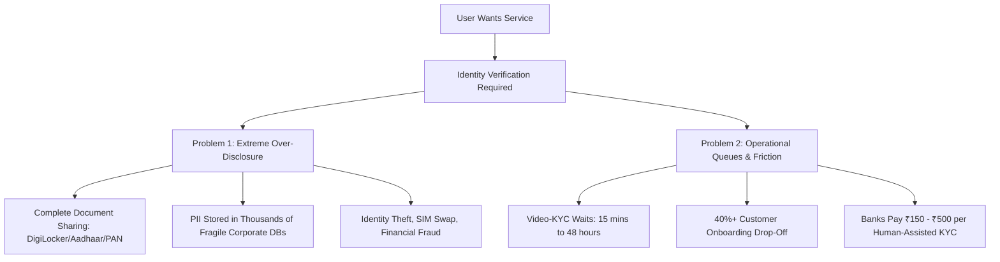

# 01. Executive Overview & Pitch

> **AegisID: Zero-Knowledge Privacy-Preserving Identity & Instant Compliance Protocol**

---

## 1. Domain
* **Primary Domain:** Web3 Infrastructure & Financial Technology (FinTech / RegTech)
* **Secondary Domain:** Privacy-Enhancing Technologies (PETs), Decentralized Identity (DID), and Edge Cryptography

---

## 2. Problem Statement: The Double Crisis of Privacy & Verification Queues

Modern digital onboarding is fundamentally broken across two dimensions:

1. **The Over-Disclosure Paradox:** To verify a single fact (e.g., age, tax status, or country of residence), users must transmit their complete identity document (Aadhaar, PAN card, Passport). Even government digital vaults like **DigiLocker** simply transfer the entire signed PDF/XML to third parties. Every bank, insurance company, broker, and hotel ends up storing photocopies and raw PII.
2. **The Verification Bottleneck (V-KYC & Manual Queues):** Financial institutions in high-velocity markets like India run extensive human-dependent Video-KYC (V-KYC) processes to comply with anti-money laundering (PMLA/RBI) rules. Users face long waiting queues, frequent network drops, and manual rejection rates, costing institutions millions in CAC (Customer Acquisition Cost).
3. **Pervasive Surveillance & Cross-App Correlation:** Traditional credentials and public wallet addresses link identity across platforms, allowing big tech, data brokers, and verifiers to trace user habits.

---

## 3. Target Users

| User Segment | Pain Point | What AegisID Delivers |
| :--- | :--- | :--- |
| **Citizens & Consumers** | Forced to upload raw Aadhaar/PAN to dozens of apps; identity theft & privacy breach fear. | **Zero-Leak Onboarding:** Instant 1-click verification without handing over document scans or PII. |
| **Banks, FinTechs & NBFCs** | Massive V-KYC queues, high human agent costs (₹150–₹500/KYC), 40% drop-off rate. | **Instant Algorithmic Verification:** Verify pre-certified credentials in < 2 seconds with zero human queues. |
| **DeFi & Web3 Protocols** | Stifled by regulators (OFAC, MiCA, FinCEN) demanding compliance without losing privacy-first users. | **Trustless On-Chain Gating:** EVM-compatible ZK proofs verifying user compliance without revealing wallet links. |
| **Credential Issuers (UIDAI/DigiLocker, Banks, Universities)** | Maintaining high-availability OAuth APIs and answering repetitive verification queries. | **Decentralized, Reusable Attestation:** Issue a credential once; user can verify it infinitely off-chain/on-chain. |

---

## 4. Why It Matters

1. **Regulatory Mandate (DPDP Act 2023 & eIDAS 2.0):** India's *Digital Personal Data Protection (DPDP) Act 2023* enforces strict **Data Minimization** (penalties up to ₹250 Crore for excessive data collection). AegisID enforces mathematical data minimization at the protocol level.
2. **Massive Cost Reduction for FinTech:** Eliminating human V-KYC queues reduces onboarding latency from 24 hours to 2 seconds, while cutting compliance operational expenditures by over 80%.
3. **Elimination of Data Breach Honeypots:** Verifiers never hold raw government ID scans, eliminating the risk of data leaks that lead to loan fraud, spoofed bank accounts, and SIM-swap crimes.

---

## 5. Proposed Solution

**AegisID** is a protocol that transforms official identity documents into **cryptographically private, reusable Zero-Knowledge Credentials stored directly on the user's edge device (mobile phone or browser)**.

* **Upstream Ingestion:** Converts authoritative identity documents (DigiLocker XML, Offline Aadhaar, or Bank Attestations) into SNARK-friendly Poseidon cryptographic commitments.
* **Edge Proving Engine:** Users generate zero-knowledge proofs on their own device in < 1.5 seconds. The proof confirms:
  * The attribute satisfies the query (e.g., `Age ≥ 18`, `PAN is Active`, `CIBIL Score ≥ 750`).
  * The credential was signed by an authorized issuer.
  * The credential has **not been revoked** (verified via an on-chain Sparse Merkle Tree).
  * A deterministic **app-scoped nullifier** prevents identity sharing or double-spending.
* **Instant Verification:** Smart contracts or backend APIs verify the proof with zero access to the underlying PII.

---

## 6. Key Features at a Glance

* **Reusable 1-Click KYC:** Complete bank or fintech onboarding in seconds without sitting in a video queue.
* **Selective Disclosure & Range Queries:** Disclose only the boolean result of a statement without revealing raw numbers.
* **Private Dynamic Non-Revocation:** Real-time on-chain revocation checking without revealing which credential is being queried.
* **Cross-App Unlinkability via Scoped Nullifiers:** Verifiers cannot link a user’s activity across multiple platforms.
* **Edge-First Proving:** Private keys and biometric/identity secrets never leave the user's phone or secure hardware.
