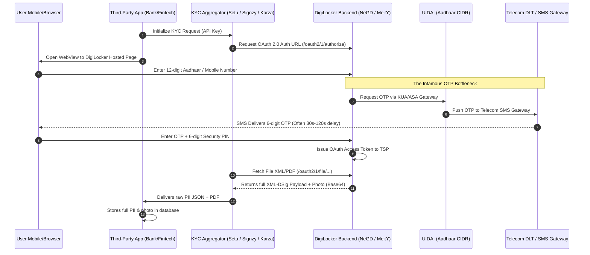

# 02. Technical Reality: How DigiLocker & Indian KYC Work (And Where ZK Actually Fits)

> To build a compelling, defensible product, we must avoid buzzwords and understand **the exact technical mechanics of DigiLocker, UIDAI OTPs, and bank onboarding today**—uncovering real engineering bottlenecks rather than forcing "blockchain" where it doesn't belong.

---

## 1. How DigiLocker Actually Works at the Backend (No Assumptions)

When you tap **"Verify via DigiLocker"** on an app like Zerodha, Groww, or a bank portal, here is the exact technical pipeline:



### The Exact Backend Architecture:
1. **OAuth 2.0 Authorization Code Flow:**
   * DigiLocker does not have an open direct data API. Third-party apps must register as an authorized **"Requester"** with the National e-Governance Division (NeGD).
   * Most banks do not integrate directly with DigiLocker; they use **TSPs (Technology Service Providers)** like **Setu (Pine Labs), Signzy, Hyperverge, or Karza**.
2. **The UIDAI ASA/KUA Gateway Dependency:**
   * DigiLocker is an **Authentication User Agency (AUA)** and **KYC User Agency (KUA)** under UIDAI.
   * When you log in with Aadhaar, DigiLocker calls UIDAI’s Central Identities Data Repository (CIDR).
3. **The Data Delivered to the Third Party:**
   * The third party receives an **XML payload signed with a digital certificate (XML-DSig)** using standard X.509 PKI issued by the Controller of Certifying Authorities (CCA India).
   * **What is inside that XML?**
     * User's full Legal Name, Gender, and exact Date of Birth.
     * Complete physical address (House/Flat No., Street, Landmark, Village/City, District, State, PIN code).
     * High-resolution/Low-resolution photo of the user (Base64 encoded JPEG).
     * Masked/Unmasked Aadhaar reference number.
4. **How the Third Party "Verifies" It Today:**
   * The third party’s server validates the digital signature on the XML against DigiLocker’s public certificate.
   * They parse the XML fields using basic backend code (e.g. checking if `DOB < current_year - 18`).
   * They feed the Base64 photo into a **Face Match AI engine** (comparing it to a live selfie captured on the user's camera).
   * **Crucial Step:** The bank then **permanently archives the complete XML and photo** in their cloud bucket (AWS S3) to produce in future RBI audits.

---

## 2. Why OTPs Fail, Delay, and Cause Massive Drop-Offs

You noted that OTPs often cause delays and server issues. This is not user error—it is an architectural flaw inherent to centralized SMS telecom routing in India:

```
┌────────────────────────────────────────────────────────────────────────┐
│                   WHY AADHAAR OTPs REGULARLY FAIL                      │
│                                                                        │
│ 1. Telecom DLT Scrubbing Lag:                                          │
│    TRAI mandates that every commercial SMS pass through a telecom      │
│    Distributed Ledger (DLT) platform (Jio/Airtel/Vilpower) for spam     │
│    template checking. During peak hours (10 AM - 2 PM), this adds       │
│    30 to 90 seconds of queue latency.                                  │
│                                                                        │
│ 2. UIDAI Gateway Concurrency Limits:                                   │
│    Over 1.4 billion citizens hit the exact same UIDAI ASA gateways     │
│    for PDS ration shops, SIM verification, EPFO logins, and banking.   │
│    Under spike loads, UIDAI throttles requests.                        │
│                                                                        │
│ 3. Session Expiration Desync:                                          │
│    DigiLocker's OAuth browser session has a 60-to-120 second timeout.   │
│    If the SMS takes 90 seconds to arrive, the session expires. The     │
│    user types the OTP, gets "Session Expired / Invalid Request", and    │
│    abandons the onboarding flow completely.                            │
│                                                                        │
│ 4. Outdated Mobile Number Mismatch:                                    │
│    Millions of citizens registered their Aadhaar with an old mobile    │
│    number they no longer possess. Updating an Aadhaar mobile number    │
│    requires a physical visit to an Aadhaar Seva Kendra.                │
└────────────────────────────────────────────────────────────────────────┘
```

---

## 3. Demystifying Web3: Where Does Blockchain ACTUALLY Belong (And Where It DOESN'T)?

Many Web3 identity projects fail because they blindly put things on a blockchain that have no business being there. Let's be brutally honest about what belongs on-chain and what does not:

### ❌ What We Should NEVER Do (The "Forced Web3" Traps):
* **Do NOT put user identity or attributes on-chain:** (No names, no Aadhaar hashes, no dates of birth). Putting personal data on a public blockchain is permanent, expensive, and directly violates GDPR and India's DPDP Act ("Right to be Forgotten").
* **Do NOT require the user to pay gas fees:** Normal citizens will never pay \$0.50 in crypto tokens just to prove their age or bank eligibility.
* **Do NOT issue Identity NFTs:** An NFT is transferrable, public, and links all your activity together. It is the opposite of privacy.

### ✅ Where Zero-Knowledge + Cryptography ACTUALLY Solves the Problem:
The true breakthrough here is **Local Edge Cryptography**, not speculative tokens:

1. **Eliminating the Live OTP & Server Dependency:**
   * With DigiLocker, every single time you verify with a new app, you must contact DigiLocker's servers and wait for a live SMS OTP.
   * **With AegisID:** You import your credential **once** (e.g. via an offline Aadhaar XML or one-time DigiLocker setup) into your phone’s local secure vault.
   * After that one-time import, your phone holds the cryptographically signed credential **locally**.
   * When you need to verify with 10 different apps, **your phone generates the zero-knowledge proof locally in 1 second offline**. No SMS OTP. No telecom delay. No DigiLocker server downtime.
2. **Eliminating Document Storage & Breach Liability:**
   * Instead of sending the bank an XML file with your photo, address, and DOB, the circuit produces a 128-byte mathematical proof:
     $$\pi = \text{Groth16}(\text{IssuerPubKey}, \text{Age} \ge 18, \text{Status} == \text{Active})$$
   * The bank checks the math. The math passes. The bank opens the account. **The bank stores zero PII.**
3. **Where Blockchain Minimalistically Fits (Decentralized Public Key & Revocation Anchor):**
   * How does the verifier know the Issuer's public key is authentic?
   * How does the verifier know the credential hasn't been revoked by the government or bank?
   * **Traditional Web2 way:** The verifier calls the Issuer’s API (`api.uidai.gov.in/check-revoked?id=123`). But this allows the Issuer to **spy on the user** and know every website the user visits!
   * **The Minimal Blockchain way:** The Issuer posts an updated **Sparse Merkle Tree (SMT) root** on a public blockchain once an hour/day. The user proves in ZK that their credential is not in that tree. The verifier checks the root on-chain. **Neither the Issuer nor the Verifier can spy on where or when the user is verifying.**

---

## 4. Summary: The True USP for Our Project

When pitching to judges or investors, our Unique Selling Proposition is clear, defensible, and grounded in real engineering:

```
┌─────────────────────────────────────────────────────────────────────────────┐
│                            THE GENUINE USP                                  │
├────────────────────────────────┬────────────────────────────────────────────┤
│ Current Reality (DigiLocker)   │ AegisID Protocol                           │
├────────────────────────────────┼────────────────────────────────────────────┤
│ • Dependent on live SMS OTPs   │ • Proof generated locally on-device        │
│   (high latency & failure).    │   in < 1.5s (Zero OTP needed).             │
│                                │                                            │
│ • Hands over entire unredacted │ • Zero data transferred (Only a 128-byte   │
│   document (photo, DOB, home). │   cryptographic mathematical proof).       │
│                                │                                            │
│ • Verifier stores raw PII      │ • Verifier stores zero PII                 │
│   (Breach & DPDP penalty risk).│   (Zero compliance liability).             │
│                                │                                            │
│ • Checking revocation queries  │ • Non-revocation proven mathematically     │
│   central servers (spying).    │   against public on-chain Merkle root.     │
│                                │                                            │
│ • Forces banks into expensive  │ • Instant, algorithmic verification        │
│   human Video-KYC queues.      │   bypasses human queues completely.        │
└────────────────────────────────┴────────────────────────────────────────────┘
```
