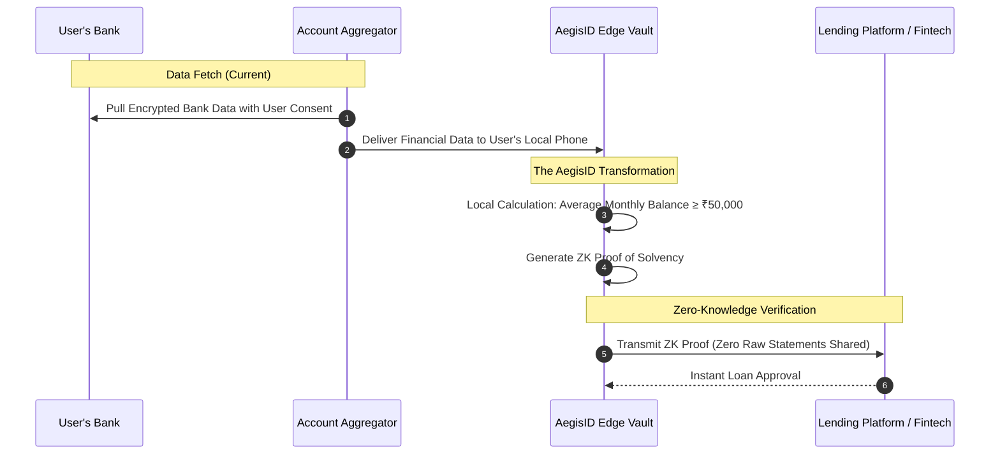

# 04. Future Vision: Banking, UPI & NPCI Integration

> Exploring how AegisID integrates into the Indian Digital Public Infrastructure (DPI) stack: **UPI (NPCI)**, **Account Aggregator (AA)**, **RuPay Credit on UPI**, and **Cross-Border Payments (LRS)**.

---

## 1. Context: The Indian Digital Public Infrastructure (DPI)

India has built the world's most sophisticated open payment and data rails:
* **UPI (NPCI):** Over 14 billion monthly transactions.
* **Account Aggregator (RBI):** Consent-driven financial data sharing network.
* **RuPay Credit on UPI:** Instant pre-approved credit lines accessible over QR codes.
* **Cross-Border UPI:** Expanding to UAE, Singapore, France, and Mauritius.

**The Missing Piece:** While payment rails are instant, **identity, compliance, and credit gating remain slow, invasive, and prone to data leaks**.

```
┌────────────────────────────────────────────────────────────────────────┐
│                        INDIAN DPI + AEGIS-ID LAYER                     │
│                                                                        │
│   Payment Layer (NPCI)   ───> UPI, RuPay, AutoPay Mandates             │
│                                           ▲                            │
│   Data Layer (RBI)       ───> Account Aggregator (AA), C-KYC           │
│                                           ▲                            │
│   PRIVACY & ZK LAYER     ───> ★ AEGIS-ID (Client Edge Proving) ★       │
│                                           ▲                            │
│   Trust Anchors (Govt)   ───> UIDAI / DigiLocker / Banks               │
└────────────────────────────────────────────────────────────────────────┘
```

---

## 2. Strategic Integration Touchpoints

### A. 1-Click Instant KYC for "RuPay Credit on UPI"
* **The Opportunity:** RBI allows pre-sanctioned credit lines and RuPay credit cards to be linked directly to UPI apps (Google Pay, PhonePe, Cred). However, activating a credit line currently triggers a cumbersome underwriting and KYC check.
* **AegisID Integration:**
  1. The user’s primary bank (e.g., HDFC or SBI) issues an attested credit-standing credential to the user’s local AegisID vault.
  2. When the user taps *"Activate Credit on UPI"* in PhonePe, AegisID generates a 1-second ZK proof:
     * `Holder has verified bank account with Tier-1 Capital`
     * `Debt-to-Income ratio < 35%`
     * `CIBIL Score ≥ 750`
  3. The credit provider instantly activates the line without demanding a video call, salary slips, or full tax returns.

---

### B. Cross-Border UPI & FEMA / LRS Compliance
* **The Problem:** When an Indian citizen travels to Dubai or Paris and pays a merchant via UPI International, the transaction falls under the **Liberalised Remittance Scheme (LRS)** governed by the Reserve Bank of India.
  * Indian law enforces a strict **$250,000 USD annual limit** and mandates Tax Collected at Source (TCS) tracking.
  * Currently, international merchants and correspondent banks require extensive paperwork or risk regulatory penalties.
* **AegisID Integration:**
  * The user's phone generates an LRS compliance proof:
    $$\text{Annual LRS Utilized} + \text{TxAmount} \le \$250,000 \quad \text{AND} \quad \text{CitizenTaxStatus} == \text{"Compliant"}$$
  * Foreign merchants and banking gateways verify the payment is legally compliant in real-time without receiving the traveler's PAN number, domestic account numbers, or overall foreign spend history.

---

### C. Merchant Onboarding & Ghost QR Fraud Elimination
* **The Problem:** The open nature of UPI QR codes has led to bad actors setting up fraudulent merchant accounts using forged Aadhaar cards. When customers scan the QR, funds are routed to mule accounts.
* **AegisID Integration:**
  * NPCI or acquiring banks require merchant QR codes to embed an **AegisID Merchant Attestation**.
  * When a customer scans the merchant QR, the customer's UPI app cryptographically verifies:
    * The merchant has an active GSTIN or business registration.
    * The business entity is legally bonded and non-blacklisted.
    * The physical location matches the authorized geo-fence.
  * **Result:** Total elimination of fraudulent mule merchant QR codes with zero friction for legitimate small vendors.

---

### D. Privacy-Preserving Account Aggregator (AA) Bridge

The RBI-regulated Account Aggregator (AA) ecosystem lets users share bank statements with lenders via consent managers (e.g., Setu, OneMoney, Finvu).

**The Current Problem with AA:**
Once a user clicks "Consent", the lender receives **6 to 12 months of unredacted bank statements** (every coffee purchase, pharmacy bill, personal transfer).

**How AegisID Supercharges AA:**


Rather than transmitting 300 pages of raw bank statements to the lender's database, the user’s phone computes the metric locally and sends only a **Zero-Knowledge Proof of Solvency**.

---

## 3. Long-Term Banking Deployment Blueprint

1. **Phase A (Current Hackathon MVP):** Self-contained ZK credential pipeline with standard EVM verification contract, web edge prover, and selective disclosure.
2. **Phase B (DPI Ingestion Engine):** Support importing real Indian identity credentials (e.g., Aadhaar offline XML signature verification inside Circom or via trusted enclave attestation).
3. **Phase C (FinTech SDK):** Provide a drop-in React Native / Flutter SDK for Indian FinTech apps to replace their V-KYC webview with an instant `<AegisVerify />` button.
4. **Phase D (NPCI / Banking Sandbox):** Propose proof-of-concept deployment in the RBI Regulatory Sandbox or NPCI Innovation Lab for automated RuPay credit and high-volume cross-border remittance gating.
