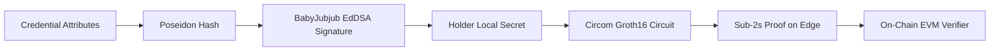

# 05. Technical Architecture & Cryptographic Primitives

> A deep technical breakdown of the mathematics, arithmetic circuits, smart contracts, and edge client execution powering AegisID.

---

## 1. Cryptographic Primitives & Design Choices



### Why These Specific Primitives Were Selected:
1. **BN254 (Alt-bn128) Pairing-Friendly Curve:**
   * Supported natively on Ethereum and EVM-compatible L2s via precompiled contracts (`0x06`, `0x07`, `0x08` for addition, scalar multiplication, and pairing checks).
   * Verifying a Groth16 proof on-chain costs only **~200,000 gas**.
2. **Poseidon Hash Function:**
   * Conventional hashes (SHA-256, Keccak-256) require 25,000–50,000 arithmetic constraints per block because they are bitwise-oriented.
   * Poseidon operates natively over the finite scalar field $\mathbb{F}_p$ of BN254, requiring **less than 250 constraints** per hash operation.
   * This represents a **100x reduction** in proving overhead, making edge/mobile execution viable.
3. **BabyJubjub Elliptic Curve & EdDSA Signatures:**
   * A twisted Edwards curve defined over the scalar field of BN254:
     $$ax^2 + y^2 = 1 + dx^2y^2$$
   * Allows verifying digital signatures issued by authorities (Banks/UIDAI) directly inside the ZK circuit in ~3,500 constraints.
4. **Groth16 Proving System:**
   * Generates constant-size proofs: exactly 3 group elements ($A \in G_1$, $B \in G_2$, $C \in G_1$), totaling just 128 bytes.
   * Ultra-fast client-side verification and minimal calldata gas costs.

---

## 2. Arithmetic Circuit Architecture (Circom 2.1)

AegisID combines three modular circuit sub-modules into a unified proving circuit:

```
┌────────────────────────────────────────────────────────────────────────┐
│                        AEGIS-ID CIRCOM CIRCUIT                         │
│                                                                        │
│   [Private Inputs]                                                     │
│   ├── User Secret Key (sk)                                             │
│   ├── Credential Attributes (Age, CIBIL, CountryCode, NetWorth)        │
│   ├── Issuer Signature (R8, S) over Poseidon Commitment                │
│   └── SMT Non-Revocation Siblings & Path                               │
│                                                                        │
│   [In-Circuit Logic]                                                   │
│   ├── 1. Verify BabyJubjub EdDSA Signature(IssuerPubKey, Commitment)  │
│   ├── 2. Evaluate Predicates: RangeProof(Age ≥ 18), Inclusion/Exclusion│
│   ├── 3. SMT Non-Membership: Verify leaf is 0 at CredentialIndex       │
│   └── 4. Calculate Nullifier = Poseidon(sk, AppScopeID)                │
│                                                                        │
│   [Public Inputs]                                                      │
│   ├── Issuer Public Key (Ax, Ay)                                       │
│   ├── AppScopeID (Context / Verifier Domain)                           │
│   ├── AppNullifier (Deterministic single-use hash)                     │
│   ├── SMT Revocation Root (On-Chain Snapshot)                          │
│   └── Predicate Query Configuration (e.g. MinAge = 18)                 │
└────────────────────────────────────────────────────────────────────────┘
```

### Module 1: Selective Disclosure & Range Checks (`AttributeVerifier.circom`)
* Uses binary bit-decomposition to prove:
  $$x - \text{Threshold} \ge 0$$
* Enforces that values fit in a 64-bit integer space without overflow, ensuring reliable comparisons (e.g., credit score or age).

### Module 2: Private Dynamic Non-Revocation (`NonRevocationSMT.circom`)
* Uses a 32-depth **Sparse Merkle Tree (SMT)**.
* When an issuer revokes a credential, they set the leaf value at `CredentialIndex` to `1` and post the new root to the blockchain.
* To prove non-revocation, the user supplies their `CredentialIndex` and the Merkle siblings as **private inputs**.
* The circuit proves:
  $$\text{LeafAt}(\text{CredentialIndex}) == 0 \quad \text{under Root}_{\text{current}}$$
* **Zero-Knowledge Guarantee:** The verifier verifies the root matches the blockchain, but never learns *which* leaf index was proven empty.

### Module 3: Sybil Resistance via Scoped Nullifiers (`ScopedNullifier.circom`)
* Computes:
  $$\text{Nullifier} = \text{Poseidon}(\text{SecretKey}, \text{AppScopeID})$$
* If a user attempts to claim the same airdrop, vote twice in the same election, or open duplicate accounts on the same portal, the smart contract checks its `mapping(bytes32 => bool)` registry and immediately reverts.
* Because `AppScopeID` varies between platforms, nullifiers are mathematically unlinkable across different applications.

---

## 3. Smart Contract Layer (Solidity)

The protocol relies on four lean EVM smart contracts:

1. **`AegisVerifier.sol`:**
   * Auto-generated Groth16 pairing verifier.
   * Takes the proof `[a, b, c]` and public inputs and returns `bool isValid`.
2. **`IssuerRegistry.sol`:**
   * Maintains the whitelist of accredited issuer public keys (e.g., Bank of Baroda, UIDAI, University).
   * Allows automated governance staking or multi-sig management.
3. **`RevocationRegistry.sol`:**
   * Stores the latest `bytes32 smtRoot` for each issuer.
   * Emits `RootUpdated(bytes32 newRoot)` events for client indexers.
4. **`NullifierRegistry.sol`:**
   * Enforces single-use execution per scope.
   * Prevents double-spend replay attacks.

---

## 4. Edge Computing & Client Vault Engine

To ensure privacy, **raw attributes and private keys must never touch a network socket**.

* **Runtime:** Browser / Mobile WebWorker running `@snarkjs/snarkjs`.
* **Asynchronous Execution:** Proving runs on background threads to keep the UI smooth and responsive (60fps).
* **Local Storage:**
  * Credentials stored in encrypted `IndexedDB` unlocked via local biometrics (WebAuthn / Passkeys / Secure Enclave).
* **Performance Benchmarks (Target for Hackathon):**
  * Total Constraints: **~12,000**
  * Proof Generation Time (M2 Mac / iPhone 13+): **~1.1 to 1.4 seconds**
  * Proof Size: **128 bytes**
  * On-Chain Gas Cost: **~210,000 gas**
