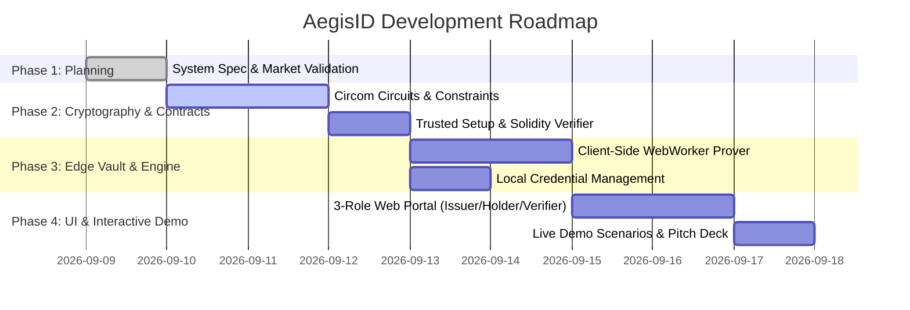

# 06. Implementation Roadmap & Hackathon Milestones

> A concrete, phase-by-phase execution plan to deliver a fully functional, judge-ready prototype.

---

## 🗺️ Master Phased Roadmap

---

## Phase 1: Conceptualization & System Specification (Status: ✅ Completed)
* [x] Formulate problem statement addressing Indian & Global identity crises (DigiLocker over-disclosure, V-KYC bank queues).
* [x] Identify and fix the 5 foundational flaws of naive ZK identity systems.
* [x] Establish high-impact use cases beyond "Age Verification" (Banking KYC, CIBIL credit proofs, SIM/Hotel privacy, DBT subsidies).
* [x] Design technical architecture (Poseidon, BabyJubjub, SMT non-revocation, Scoped Nullifiers).
* [x] Organize modular documentation hub in `docs/`.

---

## Phase 2: Cryptographic Engine & Circuit Development
* **Objective:** Build, compile, and mathematically verify the zero-knowledge arithmetic circuits and smart contracts.
* **Deliverables:**
  1. **Circom Circuits:**
     * `circuits/common/poseidon.circom`
     * `circuits/AttributeProof.circom` (Age/Credit/Income range proofs)
     * `circuits/SMTNonRevocation.circom` (32-depth Sparse Merkle Tree non-membership)
     * `circuits/Nullifier.circom` (Context-scoped nullifier generation)
     * `circuits/AegisMain.circom` (Unified core circuit)
  2. **Circuit Compilation & Groth16 Ceremony:**
     * Compile circuits to R1CS and WASM.
     * Execute Powers of Tau ceremony & generate `.zkey`.
     * Export `verification_key.json` and auto-generate Solidity `AegisVerifier.sol`.
  3. **Smart Contract Suite:**
     * `contracts/AegisVerifier.sol`
     * `contracts/IssuerRegistry.sol`
     * `contracts/RevocationRegistry.sol`
     * `contracts/NullifierRegistry.sol`
     * Automated Hardhat/Foundry test suite verifying proof acceptance and rejection.

---

## Phase 3: Client Edge Vault & Issuer Attestation Bridge
* **Objective:** Enable sub-2-second proof generation on edge devices without locking the browser UI thread.
* **Deliverables:**
  1. **Issuer Attestation Utility:**
     * Node.js / TypeScript micro-library to sign credentials using BabyJubjub private keys and generate Poseidon commitments.
     * Dynamic SMT builder to manage revocation trees and output non-membership sibling paths.
  2. **Client-Side Edge Vault:**
     * IndexedDB / WebCrypto encrypted vault for storing W3C-style credentials locally.
     * WebWorker wrapper around SnarkJS to run Groth16 witness generation and proving in background threads.
     * QR code generator and scanner for mobile verification handshakes.

---

## Phase 4: Full Interactive 3-Role Demo & Presentation Kit
* **Objective:** Deliver a stunning, unified web application that allows hackathon judges to interactively test all three roles.
* **Deliverables:**
  1. **Role 1: The Issuer Portal (Bank / Authority Mode):**
     * Issue an attested credential (e.g., "Full KYC Tier-1: Age 26, CIBIL 780, Citizen IN, Income ₹18L").
     * Revocation Dashboard: Simulate revoking a credential with 1-click and updating the on-chain SMT root.
  2. **Role 2: The Holder Vault (User Edge Mode):**
     * View encrypted credentials.
     * Selectively create proofs with slider toggles: *"Prove Age ≥ 18"*, *"Prove CIBIL ≥ 750"*, *"Prove Not Sanctioned"*.
     * Generate proof with live execution timer (< 1.5s visual benchmark).
  3. **Role 3: The Verifier Portal (dApp / Bank Mode):**
     * **DeFi Lending dApp:** Grants instant loan access when proof is verified.
     * **Tamper & Revocation Test:** Demonstrate that if an issuer revokes the credential, the verifier instantly rejects the proof on-chain.
     * **Sybil Protection Test:** Demonstrate that attempting to reuse the same proof in the same application is blocked by the nullifier registry.
  4. **Pitch Deck & Video Demo:**
     * Crisp presentation deck highlighting the Indian Banking & DPI angle, cost savings over V-KYC, and live working demo.
