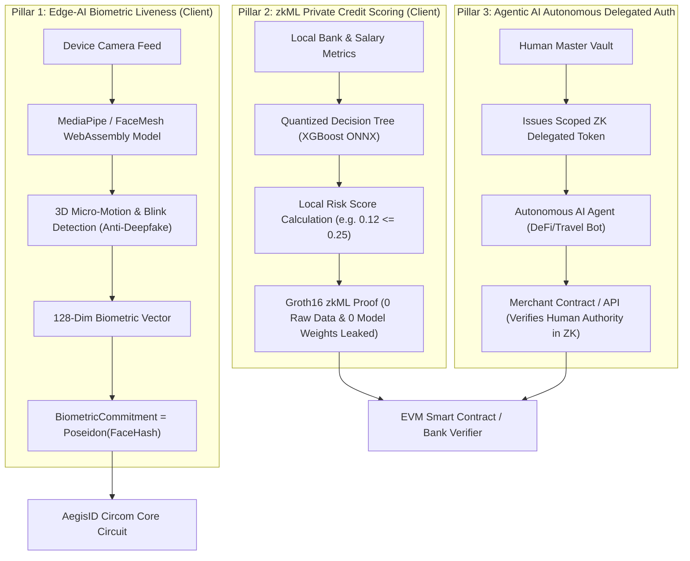

# Artificial Intelligence & Machine Learning Integration in AegisID

> **A deep dive into how AegisID combines Zero-Knowledge Proofs with Computer Vision, zkML (Zero-Knowledge Machine Learning), and Autonomous AI Agent Identity.**

---

## 1. The Trap: Avoiding "Forced AI" in Cryptography

Many Web3 and crypto hackathon projects hastily add an off-the-shelf chatbot in the corner of their interface to tick the "AI" checkbox. Hackathon judges and technical evaluators immediately discount this approach as superficial.

In **AegisID**, AI and Machine Learning solve real mathematical and identity security problems that cryptography alone cannot solve:
1. **The Biometric Binding Problem:** Cryptography can prove a digital credential exists, but cannot prove that the physical human holding the phone is the actual owner.
2. **The Proprietary Underwriting Dilemma:** Financial institutions refuse to share proprietary neural network weights, while users refuse to share raw financial transactions.
3. **The Agentic AI Identity Paradox:** Autonomous AI agents need to transact on behalf of humans without possessing master private keys or raw identity documents.

---

## 2. The 3 Architectural AI/ML Layers

---

## 3. Pillar 1: Edge-AI Biometric Liveness & Anti-Spoofing (Proof-of-Human)

### The Problem
If a malicious actor steals an unlocked phone or holds up a high-resolution printed photo or deepfake video to a webcam, naive ZK systems will execute the proof because the private key is present in memory.

### The AegisID Computer Vision Shield
1. **Local Face-Mesh Tracking:** When the user initiates proof generation, a client-side computer vision neural network (MediaPipe FaceMesh compiled to WebAssembly/WebGPU) analyzes the video feed:
   * Tracks 468 3D facial landmarks.
   * Measures physiological micro-expressions, pupillary light response, and natural blinking.
   * Calculates surface depth normals to instantly detect 2D screen replays, printed photographs, and silicone masks.
2. **In-Circuit Biometric Binding:**
   * The facial embedding vector is hashed into a `BiometricCommitment`:
     $$\text{BioHash} = \text{Poseidon}(\text{EmbeddingVector}_{128})$$
   * The credential commitment binds this biometric hash:
     $$\text{Commitment} = \text{Poseidon}(\text{userSecret}, \text{BioHash}, \text{Age}, \dots)$$
3. **The Privacy Guarantee:** The camera feed and raw biometric vectors **never leave device RAM**. The verifier only receives proof that the live human currently in front of the camera matches the biometric commitment inside the credential.

---

## 4. Pillar 2: zkML for Private Financial Underwriting

### The Problem
Traditional credit underwriting relies on complex machine learning models (gradient-boosted decision trees, random forests, or neural networks). 
* **The Bank's Dilemma:** Lenders cannot publish their AI model weights—they represent proprietary, multi-million dollar intellectual property.
* **The User's Dilemma:** Borrowers cannot upload 12 months of unredacted bank statements without exposing sensitive medical purchases, family expenses, and personal habits.

### The zkML Solution
1. The lender compiles their trained credit risk model into arithmetic circuit constraints using zkML toolchains (e.g. **EZKL** or quantized Circom lookup tables).
2. The user's device runs the model inference locally:
   * Input: Private bank metrics (Average Monthly Balance, Debt-to-Income, Cash Flow Velocity).
   * Model weights: Fixed public parameters.
   * Output: Classification boolean (`RiskScore <= Threshold`).
3. The circuit generates a zk-SNARK proof asserting:
   $$\text{"Given proprietary Model v3.2 and private FinancialVector, RiskScore} \le 0.15 \text{ (APPROVED)}"$$
4. **Outcome:** Lenders achieve automated underwriting; users preserve total financial privacy; proprietary model IP remains protected.

---

## 5. Pillar 3: Autonomous AI Agent Identity & Delegated Mandates

### The Problem
As autonomous agentic workflows expand (personal AI executive assistants, automated DeFi portfolio managers, enterprise purchasing bots), AI agents must interact with regulated merchants and banking APIs on behalf of human principals.
* Giving an AI agent your raw credit card number or unredacted passport gives the agent unlimited spending authority and creates massive identity theft vulnerability if the agent's memory or LLM context is compromised.

### The AegisID Solution: Scoped ZK Delegated Tokens
A human user issues a cryptographically bounded sub-credential to their AI agent:
1. **Scope Limits:**
   * Maximum spending limit: `MaxTxValue <= ₹10,000`.
   * Permitted merchant category: `MCC == Airlines / Travel`.
   * Expiration: `ValidUntil == Timestamp + 2 Hours`.
2. **Principal Attestation:**
   * The token proves in Zero-Knowledge that the human principal is a verified Indian citizen above 18 years of age.
3. The autonomous AI agent presents this ZK proof to the merchant API or smart contract.
4. The merchant verifies legal human authorization and compliance without ever seeing the human's real name, bank account numbers, or government ID.
