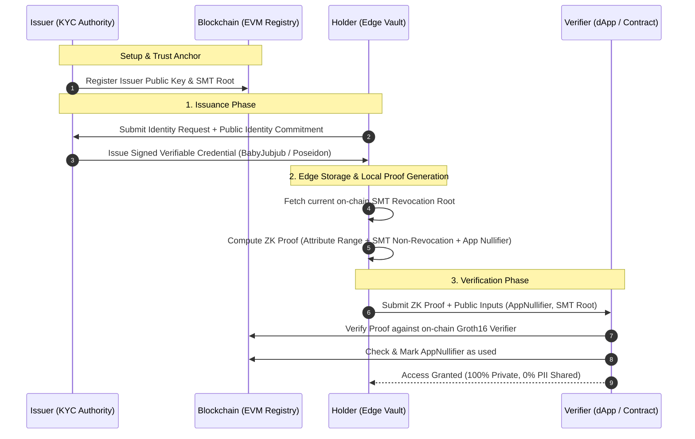

# Project Proposal: AegisID (Zero-Knowledge Privacy-Preserving Identity Protocol)

> **Decentralized, unlinkable, and compliant digital identity verification using Zero-Knowledge Proofs (ZKPs), Verifiable Credentials, and Blockchain.**

---

## 1. Executive Summary

Digital identity verification today suffers from an untenable tradeoff: services demand personal data for compliance or trust, while users are forced into **over-disclosure**—handing over complete unencrypted identity documents (passports, national IDs, tax returns) that end up stored in vulnerable centralized databases.

**AegisID** resolves this paradox by combining **W3C Verifiable Credentials**, **SNARK-based Zero-Knowledge Proofs**, and **lightweight blockchain state registries**. The system allows users to prove complex eligibility conditions (such as `Age ≥ 18`, `Residency ∉ SanctionedCountryList`, or `AccreditedInvestor == True`) directly on their local edge device without revealing raw underlying attributes, personal identifiers, or allowing verifiers to track them across applications.

---

## 2. Project Overview (Hackathon Pitch Deck Framework)

### **Domain**
* **Primary:** Web3 Infrastructure / FinTech & Regulatory Technology (RegTech)
* **Secondary:** Privacy-Enhancing Technologies (PETs) & Decentralized Identity (DID)

---

### **Problem: The Over-Disclosure & Honeypot Crisis**
1. **Unnecessary Over-Disclosure:** Proving a single boolean condition (e.g., legal drinking age or residency) currently requires exposing full name, exact date of birth, home address, and government document ID numbers.
2. **Centralized Data Honeypots:** Verifiers and intermediate KYC providers warehouse gigabytes of toxic PII (Personally Identifiable Information), creating massive targets for identity theft, fraud, and data leaks.
3. **Pervasive Cross-Platform Tracking:** Existing decentralized identity schemes often rely on public wallet addresses or static credential identifiers, allowing dApps and analytics engines to correlate and profile user behavior across services.
4. **Metadata Leaks in Revocation:** Naive revocation checks (querying a public registry directly for a credential ID) leak user activity and transaction timing, breaking zero-knowledge guarantees.

---

### **Target Users**
* **End Users / Web3 Citizens:** Privacy-conscious individuals who want to access age-gated platforms, decentralized finance (DeFi), or governance voting without doxxing themselves or having their wallets linked across apps.
* **DeFi Protocols & Regulated dApps (Verifiers):** dApps that need to satisfy stringent regulatory mandates (OFAC sanctions compliance, MiCA requirements, jurisdiction gating, accredited investor thresholds) without taking on the regulatory liability of holding user PII.
* **Credential Issuers (Institutions, KYC Providers, Employers):** Trusted organizations wanting to issue tamper-evident, reusable digital credentials that users can hold securely without requiring the issuer to maintain always-online verification endpoints.

---

### **Why It Matters**
* **Regulatory Inevitability:** Regulations like the EU's **eIDAS 2.0** and **MiCA**, along with global data privacy mandates (GDPR, CCPA), legally require data minimization and privacy-by-design.
* **Liability Elimination:** The average cost of a corporate data breach exceeds $4.4M. By never collecting or storing PII, verifiers eliminate compliance storage costs and data breach liability.
* **Unlocking Institutional DeFi:** Large-scale institutional liquidity cannot interact with anonymous counterparties, yet DeFi users resist centralized KYC. AegisID provides the mathematical middle ground: **Cryptographically Provable Compliance without Surveillance.**

---

### **Proposed Solution**
A modular, three-tier architecture:
1. **Issuer:** Attests to user attributes off-chain and issues cryptographically signed W3C-compliant Verifiable Credentials using SNARK-friendly signatures (EdDSA / BabyJubjub).
2. **Holder (Local Edge Vault):** Stores credentials securely in the user’s local browser or mobile enclave. Generates client-side zero-knowledge proofs (Groth16/Plonky) in sub-2 seconds using WebWorkers or WebGPU.
3. **Verifier (Smart Contract or Web2 API):** Instantly verifies the validity of the proof, confirms issuer authenticity, checks non-revocation via an on-chain Sparse Merkle Tree (SMT) root, and registers a single-use app-scoped nullifier.

---

### **Key Features**

* **Selective Attribute & Range Disclosure:** Prove numeric and categorical statements (e.g., `Age ≥ 18`, `Income ≥ Threshold`, `Jurisdiction == Allowed`) without disclosing the actual values.
* **Zero-Knowledge Non-Revocation Proofs:** Credentials can be dynamically revoked by issuers via an on-chain Sparse Merkle Tree (SMT). The holder generates a ZK proof of non-membership in the revocation set without revealing which credential index belongs to them.
* **Deterministic App-Scoped Nullifiers:** Prevents Sybil attacks and double-actions (e.g., voting twice or claiming multiple airdrops) by producing a unique deterministic nullifier per platform:
  $$\text{Nullifier} = \text{Poseidon}(\text{HolderSecretKey}, \text{AppDomainID})$$
  This guarantees single-use per service while maintaining complete unlinkability across different services.
* **Sub-2-Second Edge Proving:** Built with SNARK-friendly Poseidon hash primitives and optimized Circom circuits, ensuring seamless mobile/browser performance without high computational latency.
* **Dual-Target Verification:** Verifiable both trustlessly on EVM smart contracts (for DeFi gating) and off-chain via a TypeScript/Go SDK (for Web2 platforms).

---

### **Unique Angle: What Makes AegisID Stand Apart**

| Standard Hackathon ZK Projects | AegisID Approach |
| :--- | :--- |
| **Toy KYC demo:** Static JSON files with hardcoded credentials and fake signatures. | **Standards-Aligned & Production-Ready:** W3C Verifiable Credential data model with BabyJubjub/EdDSA signatures and Poseidon commitments. |
| **Omits Revocation:** Ignores credential expiry/revocation or checks it via a public ID query that doxes the user. | **Private Non-Revocation in ZK:** Verifies non-membership inside the zero-knowledge circuit against an on-chain SMT root. |
| **Vulnerable to Sybil & Replay Attacks:** Unlinkable proofs allow one credential to be reused indefinitely by multiple parties. | **App-Scoped Deterministic Nullifiers:** Enforces strict one-person-one-action per application context without tracking. |
| **Slow WASM Proving (15–45s):** Heavy circuits cause browser tab freezes and mobile crashes. | **Optimized Edge Execution:** Tailored arithmetic circuits designed for ultra-fast, client-side proof generation (< 2 seconds). |

---

### **Why This Could Work (Feasibility & Timing)**
1. **Matured Cryptographic Primitives:** Circom 2.1+, SnarkJS, and Poseidon hash algorithms have stabilized, making zero-knowledge proof generation in JavaScript/WASM accessible on everyday mobile devices.
2. **Market Urgency:** Regulators are increasingly penalizing non-compliant DeFi, while consumers and protocols are rejecting centralized surveillance. The market is actively looking for privacy-preserving compliance tools.
3. **Clean Hackathon Scope:** The cryptographic and smart contract components can be built modularly, allowing a functional, high-impact end-to-end prototype to be demonstrated live.

---

## 3. The 5 Foundational Flaws & Engineering Countermeasures

| # | Pitfall in Naive Implementations | AegisID Countermeasure |
| :--- | :--- | :--- |
| **1** | **Generic "Age $\ge$ 18" Cliché:** Boring to judges, lacks commercial context. | **Contextual Compliance Suite:** Target high-value compliance: DeFi Sanctions Exemption (OFAC list non-membership) + KYC Accreditation. |
| **2** | **Circular Trust (Fake Issuers):** Issuing arbitrary credentials to oneself makes verification meaningless. | **Cryptographic Attestation Chain:** Anchor credentials to trusted public key registries on-chain, proving the issuer's public key was actively staked/whitelisted at the time of issuance. |
| **3** | **Revocation Linkability Leak:** Querying revocation status reveals timestamp and identifier. | **Sparse Merkle Tree Non-Membership Proof:** The proof mathematically proves the user's credential leaf is empty in the revocation tree root. |
| **4** | **Credential Sharing & Sybil Duplication:** One verified user shares proofs with 50 unverified users. | **Scoped Nullifiers & Wallet-Binding:** Ties the credential commitment to the user's local signing key and generates context-specific nullifiers. |
| **5** | **Client-Side Latency:** Circuits with standard SHA-256 or Keccak take hundreds of thousands of constraints. | **SNARK-Friendly Poseidon Hash:** Slashes circuit constraints by over 90%, achieving lightweight proving suitable for edge devices. |

---

## 4. End-to-End System Flow

---

## 5. Technical Stack Architecture

* **Zero-Knowledge Circuit Layer:**
  * **Circom 2.1.x:** Language for defining arithmetic constraint systems.
  * **SnarkJS / Groth16:** Proving system (low gas cost verification on EVM, ~220k gas).
  * **Poseidon Hash & BabyJubjub Curves:** For efficient in-circuit hashing and signature verification.
* **Smart Contract Layer:**
  * **Solidity:** EVM contract suite deployed on an Ethereum L2/testnet (e.g., Arbitrum Sepolia or Polygon Amoy).
  * **Contracts:**
    1. `IssuerRegistry.sol` (Tracks authorized issuer public keys).
    2. `RevocationRegistry.sol` (Stores on-chain SMT roots updated by issuers).
    3. `NullifierRegistry.sol` (Guarantees single-use actions per scope).
    4. `Verifier.sol` (SnarkJS auto-generated Groth16 pairing check).
* **Edge & Client Layer:**
  * **Framework:** React + TypeScript + Vite.
  * **ZK Prover Runtime:** SnarkJS running in client-side WebWorkers to prevent UI thread blocking.
  * **Local Storage:** Encrypted IndexedDB / Web Crypto API for credential holding.

---

## 6. Implementation Roadmap

### **Phase 1: Project Alignment & Proposal (Current)**
- [x] Finalize domain, problem statement, and unique value proposition.
- [x] Analyze systemic flaws and determine cryptographic countermeasures.
- [x] Document project specification in `docs/proposal.md`.

### **Phase 2: Cryptographic Circuits & Contracts**
- [ ] Implement Circom circuits:
  - `AttributeVerifier.circom` (Selective disclosure & range proof).
  - `NonRevocationSMT.circom` (Proof of non-membership in revocation tree).
  - `ScopedNullifier.circom` (Unique nullifier derivation).
- [ ] Compile circuits, execute trusted setup ceremonies (groth16), and export `.zkey` and `.wasm`.
- [ ] Implement and test EVM smart contracts.

### **Phase 3: Client-Side Edge Vault & Web SDK**
- [ ] Build local credential storage and WebWorker-based proof generator.
- [ ] Integrate Issuer signing utility (EdDSA over BabyJubjub).
- [ ] Build off-chain and on-chain verification connectors.

### **Phase 4: Unified Demo Interface & Pitch Assets**
- [ ] Build a 3-role interactive web application:
  1. **Issuer Portal:** Issue credential with custom attributes.
  2. **Holder Vault:** View credential attributes, inspect cryptographic commitments, and generate one-click proofs.
  3. **Verifier dApp:** Gated DeFi portal or compliance verification check rejecting revoked or duplicate nullifiers.
