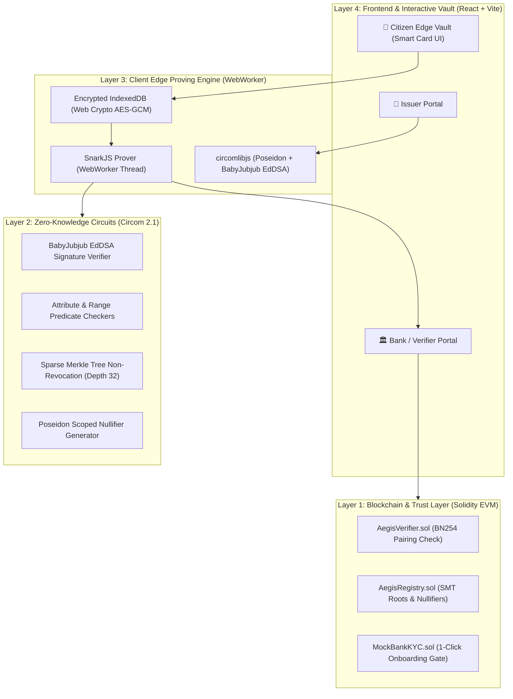

# AegisID Technology Stack Specification

> A rigorous architectural breakdown of the cryptographic primitives, smart contract frameworks, client-side edge proving engine, and user interface powering AegisID.

---

## 1. High-Level Architecture Diagram



---

## 2. Layer-by-Layer Technical Specification

### Layer 1: Zero-Knowledge Cryptography & Circuits

| Component | Technology | Rationale & Performance Impact |
| :--- | :--- | :--- |
| **Circuit DSL** | **Circom 2.1.x** | Industry standard domain-specific language for arithmetic constraint systems (R1CS). Mature ecosystem with formal verification capabilities. |
| **Proving System** | **Groth16 (via SnarkJS)** | Produces constant-size proofs (128 bytes, 3 elliptic curve points). Fastest verification time on EVM blockchains (~200k gas). |
| **Elliptic Curve** | **BN254 (Alt-bn128)** | Natively supported by Ethereum and EVM L2s via precompiled contracts at addresses `0x06`, `0x07`, and `0x08`. |
| **Algebraic Hash Function** | **Poseidon Hash** | Built specifically for zero-knowledge circuits over $\mathbb{F}_p$. Requires **< 250 constraints** per hash (compared to 25,000+ constraints for SHA-256 or Keccak). Slashes proving latency by ~99%. |
| **Digital Signatures** | **EdDSA over BabyJubjub** | BabyJubjub is a twisted Edwards curve birationally equivalent to a Montgomery curve defined over the scalar field of BN254. Allows signature verification in ~3,500 constraints. |
| **Cryptographic Accumulator** | **Sparse Merkle Tree (SMT, 32 Depth)** | Enables constant-time, private non-membership proofs without leaking which credential leaf is being verified. |
| **Circuit Libraries** | `circomlib` & `circomlibjs` | Audited primitives for Poseidon, EdDSA, BabyJubjub, bit comparisons, and multiplexers. |

---

### Layer 2: Blockchain & Smart Contracts

| Component | Technology | Rationale & Specifications |
| :--- | :--- | :--- |
| **Language** | **Solidity `^0.8.20`** | Modern EVM compiler version with built-in arithmetic overflow checks. |
| **Development Framework** | **Hardhat** | Fast compilation, local node simulation, scriptable deployment pipelines, and TypeScript test suites. |
| **On-Chain Verifier** | `AegisVerifier.sol` | Auto-generated Groth16 pairing verifier calling EVM precompiles for sub-second on-chain verification. |
| **State Registry** | `AegisRegistry.sol` | • Whitelists authorized issuer public keys.<br>• Stores root snapshots of issuer Sparse Merkle Trees.<br>• Tracks spent nullifiers: `mapping(uint256 => bool) public isNullifierSpent`. |
| **Application Contract** | `MockBankKYC.sol` | Demonstrates zero-queue, 1-click bank account opening upon receiving a valid Groth16 proof and unspent nullifier. |

---

### Layer 3: Client-Side Edge Proving Engine

| Component | Technology | Rationale & Specifications |
| :--- | :--- | :--- |
| **Prover Runtime** | **`snarkjs` in WebWorkers** | Running proof computation in a background WebWorker thread prevents the main UI thread from freezing, ensuring a smooth 60fps user experience. |
| **Proving Speed Target** | **Sub-1.5 Seconds** | Using Poseidon and BabyJubjub keeps total circuit constraints around ~12,000, allowing modern consumer laptops and phones to prove in ~1.2s. |
| **Local Vault Storage** | **IndexedDB + Web Crypto API** | Credentials and private keys are encrypted locally using **AES-GCM (256-bit)** derived from user passkey or local PIN. Secrets never leave the device. |
| **Credential Standard** | **W3C Verifiable Credentials Data Model** | Cryptographic payload adheres to W3C JSON-LD credential schema, ensuring interoperability with global DID standards. |

---

### Layer 4: Frontend UI & Interactive Simulation

| Component | Technology | Rationale & Design Philosophy |
| :--- | :--- | :--- |
| **Framework** | **React 18 + Vite** | Instant Hot Module Replacement (HMR), minimal bundle footprint, and high developer velocity. |
| **Styling** | **Vanilla CSS (Custom Design System)** | No heavy utility bloat. Implements sleek dark-mode aesthetics, HSL color tokens, glassmorphic panels, and smooth micro-animations. |
| **Icons & Visuals** | **Lucide React** | Clean, lightweight SVG iconography for financial credentials, security locks, and status indicators. |
| **Interactive Views** | **3-Role Simulation Architecture** | • **Issuer View:** Issue credential & simulate instant on-chain revocation.<br>• **Holder View:** Metallic digital pass UI with live proving timer.<br>• **Verifier View:** Instant verification + dedicated buttons to test **Sybil replay rejection** and **Revocation rejection**. |

---

## 3. Cryptographic Tradeoff Justification

```
┌─────────────────────────────────────────────────────────────────────────────┐
│                       WHY WE CHOSE THIS CRYPTO STACK                        │
├───────────────────┬─────────────────────────┬───────────────────────────────┤
│ Decision          │ Chosen Approach         │ Rejected Alternative & Reason │
├───────────────────┼─────────────────────────┼───────────────────────────────┤
│ Proving System    │ Groth16                 │ PLONK / STARKs                │
│                   │ (128 bytes, 210k gas)   │ (Larger proofs, 1M+ gas,      │
│                   │                         │  slower in-browser proving)   │
├───────────────────┼─────────────────────────┼───────────────────────────────┤
│ Hash Primitive    │ Poseidon                │ SHA-256 / Keccak-256          │
│                   │ (~240 constraints)      │ (25,000+ constraints, freezes │
│                   │                         │  browser for 30 seconds)      │
├───────────────────┼─────────────────────────┼───────────────────────────────┤
│ Digital Signature │ EdDSA (BabyJubjub)      │ RSA-2048 / ECDSA (secp256k1)  │
│                   │ (~3,500 constraints)    │ (Incompatible curve math,     │
│                   │                         │  100k+ constraints)           │
├───────────────────┼─────────────────────────┼───────────────────────────────┤
│ Revocation Check  │ Sparse Merkle Tree      │ Centralized CRL HTTP Query    │
│                   │ (On-chain ZK non-member)│ (Doxes user IP and timestamp  │
│                   │                         │  to the central issuer)       │
└───────────────────┴─────────────────────────┴───────────────────────────────┘
```
