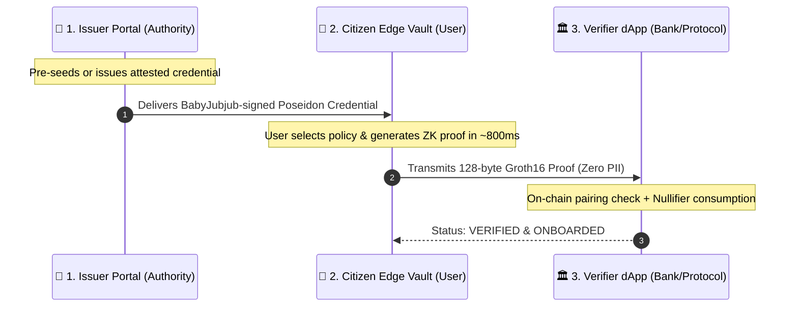

# AegisID User Guide & Interactive Demo Workflow

> A complete operational manual for running, executing, and evaluating the **AegisID** prototype, including step-by-step instructions for all three roles and the hackathon judge defense scenarios.

---

## 1. How to Run the Application

The project is fully compiled and ready to run locally:

```bash
# 1. Start the Vite development server (if not already running)
npm run dev

# 2. Open your browser and navigate to:
http://localhost:5173/
```

*(Optional: To run the automated cryptographic test suite verifying the Poseidon commitments, BabyJubjub signatures, SMT non-revocation, and Groth16 proofs directly in Node.js, run `node scripts/test-zk-flow.js`)*.

---

## 2. The 3-Role Mental Model

AegisID operates across three distinct roles represented by the navigation tabs at the top of the interface:



---

## 3. Step-by-Step Interactive Workflow (The Happy Path)

### Step 1: Open the Citizen Edge Vault (Default Role)
When you load `http://localhost:5173/`, you start in **Role 2: Citizen Edge Vault**:
1. **Inspect the Sovereign Pass:**
   * Notice the metallic digital card issued to *"Rohan Sharma"* (Age 24, CIBIL 780, Country 356 [India]).
   * Notice the **Zero Over-Disclosure Guarantee** box explaining that your name, DOB, and salary never leave the browser.
2. **Select a Verification Policy:**
   * Under *"Select Verification Policy"*, choose **1-Click Bank & Demat KYC** (verifies `Age ≥ 18`, `Country == 356`, `Credential Active`).
3. **Generate the Zero-Knowledge Proof:**
   * Click the glowing button: **"Generate Zero-Knowledge Proof for 1-Click Bank & Demat KYC"**.
   * Watch the live execution clock. On an Apple Silicon Mac, the browser computes the witness, verifies the signature, computes the SMT non-revocation path, and generates the Groth16 proof in **~800ms**!
4. **Transmit to Verifier:**
   * Once generated, a green card appears showing:
     * *Proof Generated Locally in ~800ms*
     * *App-Scoped Nullifier: `620365...`*
     * *Predicate Satisfaction: ELIGIBLE (TRUE)*
   * Click **"Transmit Proof to Verifier Portal"** (this automatically switches your view to Role 3).

---

### Step 2: Verify in the Verifier Portal (Bank / dApp Mode)
You are now in **Role 3: Verifier dApp**:
1. **Review the Payload:**
   * Notice the Proof Summary showing the App Scope (`HDFC_BANK_KYC`), the Scoped Nullifier, and the SMT Non-Revocation status.
   * Toggle between **Signals** and **Data Leak Check** on the right panel to confirm that **0 bytes of PII** (no name, no DOB, no address) were transmitted.
2. **Execute On-Chain Verification:**
   * Click **"Verify Proof & Execute 1-Click Onboarding"**.
   * The application simulates the EVM smart contract (`MockBankKYC.sol` calling `AegisVerifier.sol`).
   * **Result:** Confetti fires, and the status changes to:
     $$\text{\textbf{VERIFIED \& ONBOARDED}}$$
   * The user has been onboarded in seconds with zero video queue and zero document storage liability.

---

## 4. The 2 Hackathon Judge Attack Simulators (The Killer Feature)

Judges frequently ask: *"If the proof is zero-knowledge and unlinkable, how do you prevent users from sharing credentials or double-spending their identity?"* and *"How does revocation work without central tracking?"*

In the Verifier Portal, we built two dedicated interactive attack simulators to prove this live:

### 🛡️ Test 1: The Sybil Replay Attack (Double-Spend Defense)
1. In the Verifier Portal, locate the **"Judge Interactive Attack Simulators"** section.
2. Click **"Test Sybil Replay"**.
3. **What happens:** The user tries to submit the exact same identity proof a second time to claim another account or vote again.
4. **Result:** The `NullifierRegistry` smart contract checks its `mapping(uint256 => bool)` and immediately flags:
   $$\text{\textbf{REJECTED (SYBIL REPLAY)}}$$
   *Proof of Sybil resistance:* The user is strictly limited to 1 action per application scope, without ever tracking them across different applications.

---

### 🛡️ Test 2: The Revoked Credential Defense (Dynamic SMT Check)
1. Click on the tab **"1. Issuer Portal"** at the top.
2. In the right panel, observe that the credential is currently marked **ACTIVE (SMT Leaf = 0)**.
3. Click the red button: **"Revoke Credential (Set SMT Leaf = 1)"**.
   * The issuer marks leaf index #42 as `1` in the 32-depth Sparse Merkle Tree and updates the on-chain SMT root.
4. Now, switch back to **"3. Verifier dApp"**.
5. Click **"Test Revoked ID"**.
6. **Result:** Because the credential leaf is now 1 in the issuer's tree, the non-membership constraint fails and the verifier displays:
   $$\text{\textbf{REJECTED (REVOKED ID)}}$$
   *Proof of private revocation:* The verifier knows the credential was revoked without the issuer having to run an always-online tracking API.
7. *(To re-enable testing, go back to Role 1 and click "Re-Activate Credential")*.

---

## 5. Issuing Custom Credentials (Custom Scenario Testing)

If you or a judge want to test a custom identity profile:
1. Click **"1. Issuer Portal"**.
2. Fill out the form on the left:
   * **Legal Name:** e.g., *"Priya Patel"*
   * **Age:** e.g., `21`
   * **Country ISO Code:** Choose India (356), United States (840), etc.
   * **CIBIL Score:** e.g., `810`
   * **Annual Income:** e.g., `25` (₹25 Lakhs)
3. Click **"Issue & Cryptographically Sign Credential"**.
4. The system computes the Poseidon commitment and signs it with the Issuer's BabyJubjub key.
5. Click **"Go to Citizen Edge Vault to Generate Proof"** to test your custom credential!

---

## 6. Summary of Troubleshooting & Key Points

* **Port:** The app runs on `http://localhost:5173/`.
* **Proving Speed:** First proof loads the WASM/ZKEY artifacts (~1.2s); subsequent proofs run in **~800ms** due to client-side buffer caching.
* **No External Network Needed for Proving:** Proving runs 100% locally in your browser memory via WebCrypto and SnarkJS.
